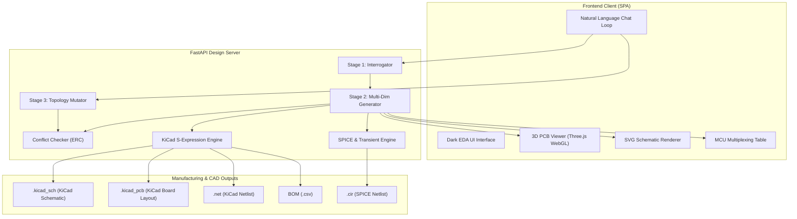

# AutonomousHardwareArchitect-AI (AHA-AI)

> **Engineering preview — not qualified for manufacturing or safety-critical use.**

See [engineering roadmap](docs/ENGINEERING_ROADMAP.md) for implementation status and evidence requirements.

AutonomousHardwareArchitect-AI compresses the traditional hardware engineering lifecycle by translating human functional prompts into interactive draft architectures that require native-tool validation and engineering review before manufacturing.

---

## 🌟 Key Features

- **Protocol Stage 1: Dynamic Core Interrogation**: Guided sequential discovery dialogues (Form Factor → Power & Efficiency → Core Processor → Peripherals & Sensors).
- **Protocol Stage 2: Multi-Dimensional Generation Matrix**:
  - **KiCad Native Netlists & Schematics**: Native `.kicad_sch` and `.kicad_pcb` files compliant with KiCad 6/7/8/9.
  - **3D Mechanical Layout**: Real-time Three.js / WebGL visualization with physical footprints, traces, and perimeter connectors.
  - **Virtual Testbench & Digital Twins**: Interactive MCU pinout mapping, alternate multiplexing functions, and SPICE transient simulation netlists.
- **Protocol Stage 3: Interactive Chat Mutation Loop**: Live modifications (e.g., swapping LDOs for Buck converters, adding status LEDs, routing buttons) with real-time Electrical Rule Checks (ERC) and delta patching.
- **DFM Electrical Guardrails**:
  - Automatically injects **0.1µF RF bypass and 10µF bulk decoupling capacitor pairs** for every IC power rail.
  - Enforces **0603 passive guidelines** for high production yield.
  - Prevents short circuits and conflicting power output connections.

---

## 🏗️ System Architecture



---

## 🚀 Quickstart & Installation

### 1. Requirements
- Python 3.10+
- Modern Web Browser with WebGL 2.0 support

### 2. Install Dependencies
```bash
pip install -r requirements.txt
```

### 3. Run the Server
```bash
uvicorn app.main:app --host 0.0.0.0 --port 8000 --reload
```

Open your browser to: **`http://localhost:8000`**

### 4. Run the Test Suite
```bash
python run_tests.py
```

---

## 📐 Output Formats

Every generation produces three standardized markdown-wrapped structural blocks:

### 1. `[DIALOGUE]`
Conversational review explaining design decisions, power topologies, DFM recommendations, and component selections.

### 2. `[PINOUT_MAP]`
Markdown table tracking pin numbers, alternate pin functions, multiplexed protocols (SPI, I2C, UART, PWM, ADC), and destination net connections.

### 3. `[TOPOLOGY_DATA]`
Structured JSON schema specifying component placements, 3D spatial coordinates, nets, and simulation configurations:

```json
{
  "project_metadata": { "id": "uuid", "base_mcu": "ESP32-S3-WROOM-1" },
  "components": [
    { "id": "U1", "part": "ESP32-S3-WROOM-1", "package": "Module_ESP32-S3-WROOM-1", "x": 0, "y": 0, "z": 0, "rotation": 0 },
    { "id": "J1", "part": "USB-C-16P", "package": "USB-C", "x": -34, "y": -10, "z": 0, "rotation": 270 }
  ],
  "nets": [
    { "name": "3V3_RAIL", "connections": ["U2.VOUT", "U1.3V3"] }
  ],
  "simulation": { "test_points": ["U2.VOUT"], "max_load_test_mA": 500 }
}
```

---

## 🛠️ KiCad Integration

AutonomousHardwareArchitect-AI generates native KiCad files that can be opened directly in **KiCad 6, 7, 8, or 9**:
- **Schematic**: S-expression symbol instances, hierarchical power nets, and reference designators.
- **PCB**: Board edge cuts (`Edge.Cuts`), SMD footprints, pad clearances, and coordinate mappings.
- **BOM**: Bill of materials ready for JLCPCB, PCBWay, or DigiKey quoting.

---

## 📄 License
MIT License. Open-source for the embedded engineering community.
